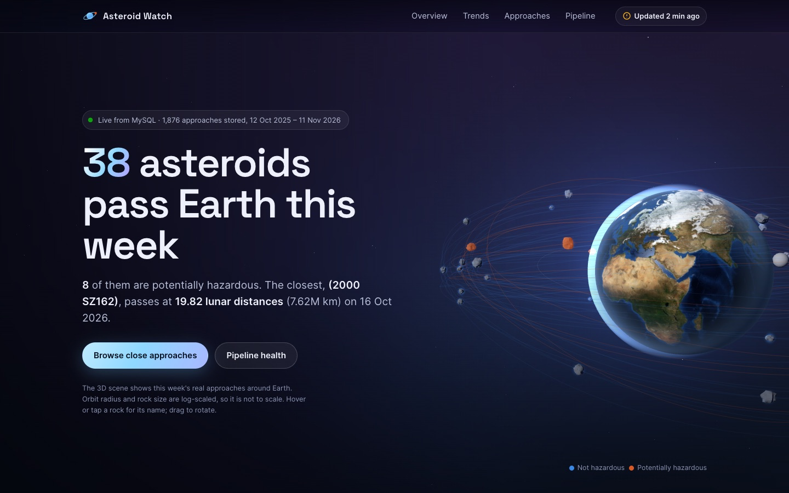
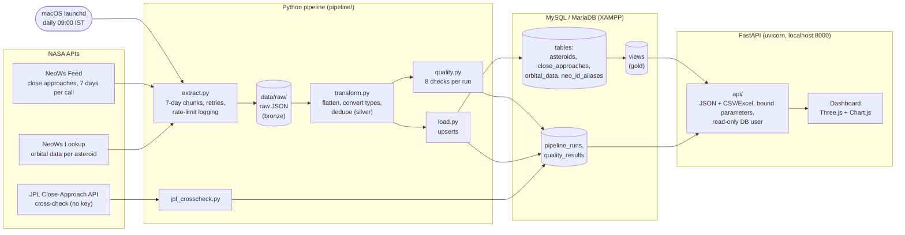
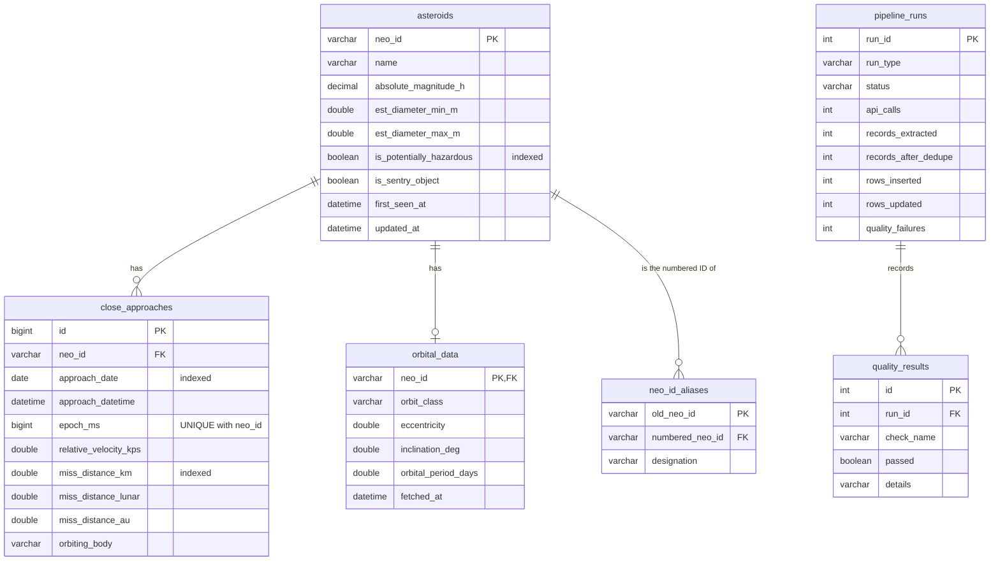
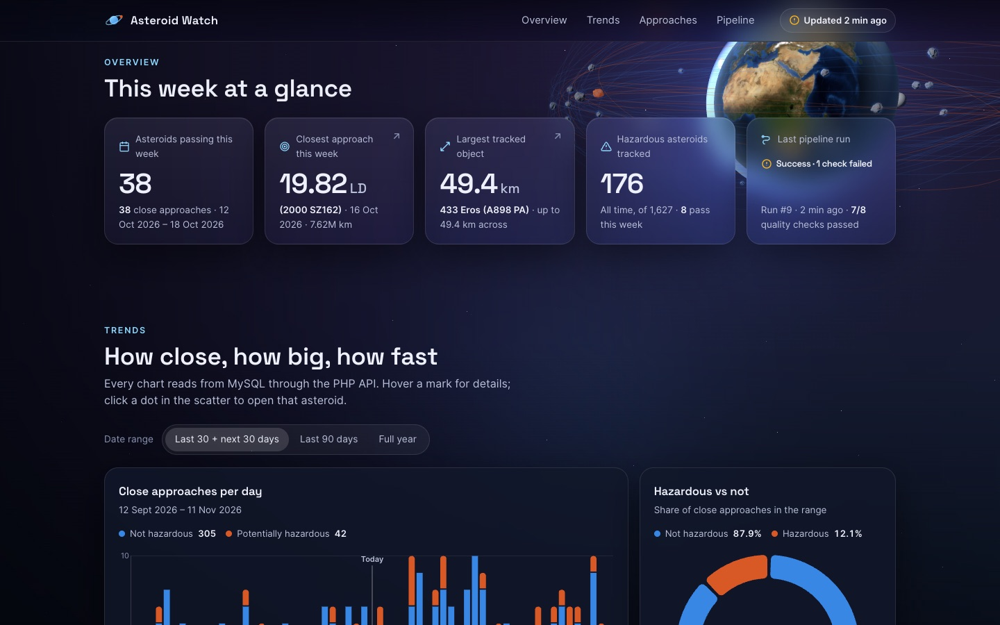
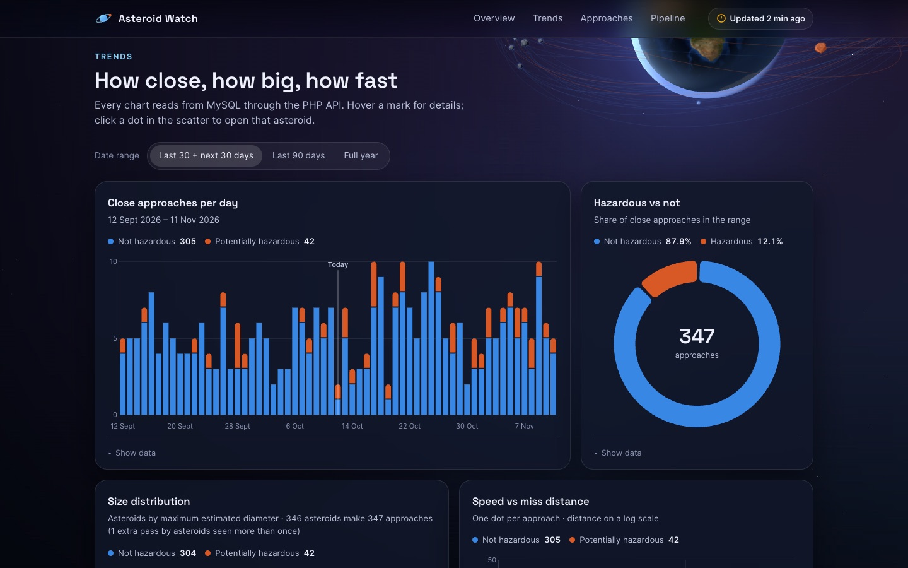
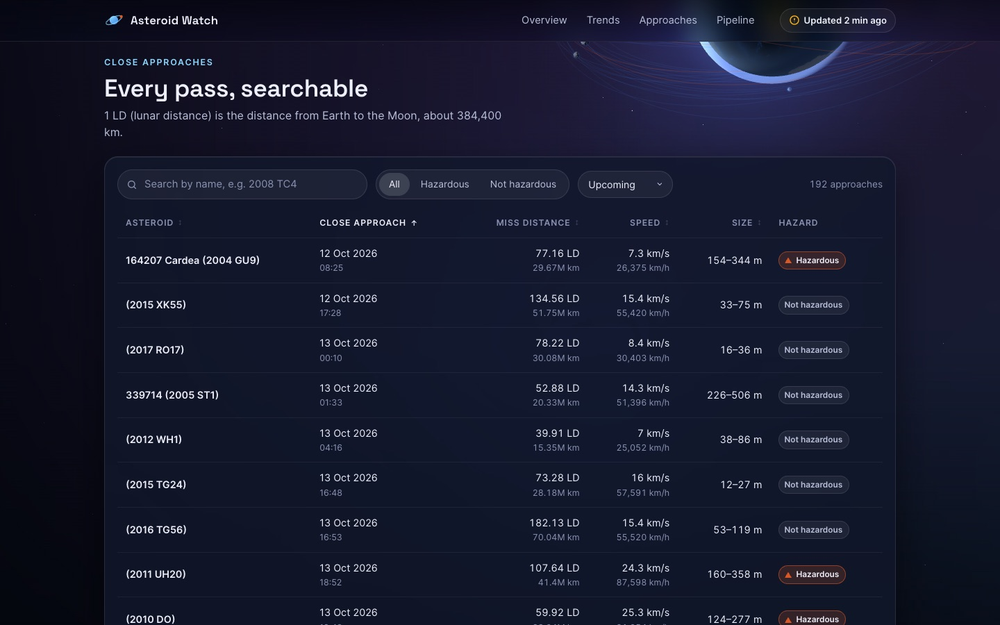
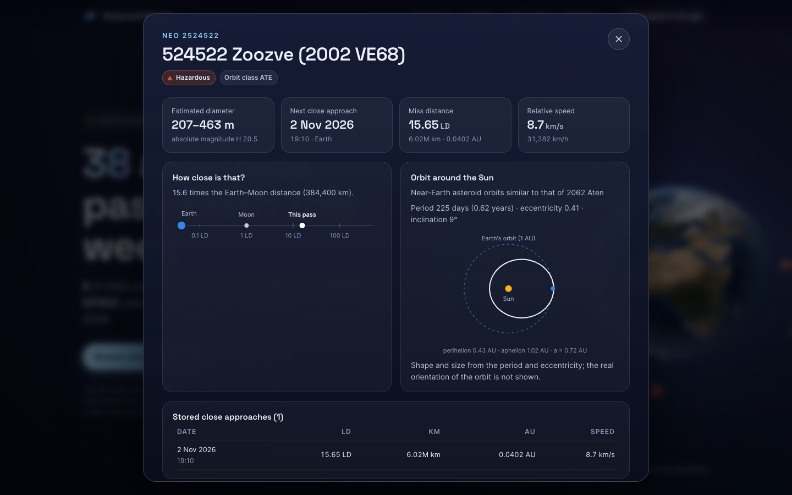
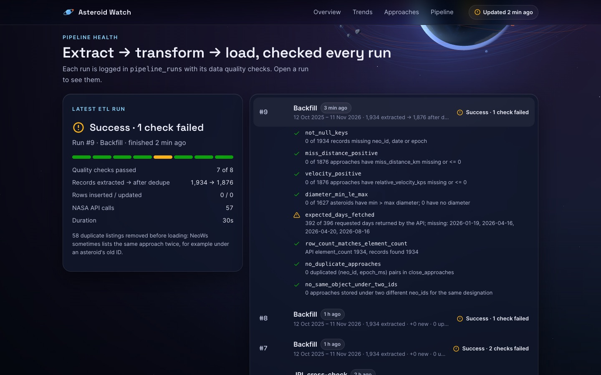
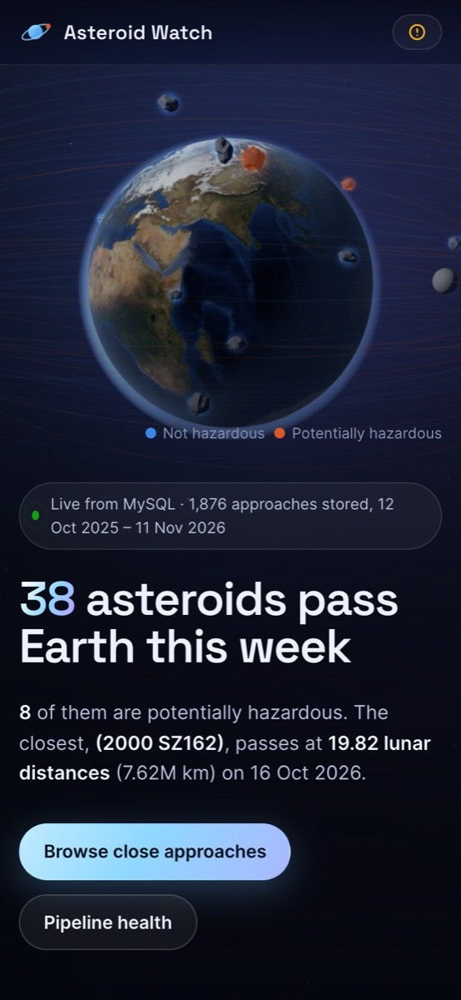

# Asteroid Watch

**An automated data pipeline for tracking near-Earth asteroids with NASA APIs.**

Asteroid Watch extracts close-approach data from NASA's NeoWs API every day. It transforms the nested JSON into clean relational tables, checks data quality, and loads the result into MySQL running in XAMPP. An animated space-themed dashboard served by a FastAPI app (v2; the original PHP API is kept in `legacy/php/`) shows the data, with a 3D Earth surrounded by this week's real asteroid approaches.

Built as a Data Engineering project (BCA, 5th semester).



| Metric | Value (as of 2026-10-12) |
|---|---|
| Date range loaded | 12 Oct 2025 – 11 Nov 2026 (365 days back, 30 ahead) |
| Asteroids | 1,627 (176 potentially hazardous) |
| Close approaches | 1,876 (188 by hazardous asteroids) |
| Asteroids with orbital data | 578 (filled in daily, hazardous first) |
| Pipeline runs logged | 9, with 41 quality-check results |
| Tests | 96 offline unit tests + 10 API integration tests |

---

## Contents

1. [Architecture](#architecture)
2. [Database (ER diagram)](#database)
3. [Setup from zero](#setup-from-zero)
4. [How to run](#how-to-run)
5. [Data quality](#data-quality)
6. [Screenshots](#screenshots)
7. [Project structure](#project-structure)
8. [Data sources](#data-sources)
9. [Limitations](#limitations)
10. [Further documentation](#further-documentation)

---

## Architecture



**Medallion layers:**
- **Bronze:** raw API responses saved unchanged (with the API key redacted) in `data/raw/<run date>/`.
- **Silver:** flat, typed, deduplicated rows produced in memory by `transform.py`.
- **Gold:** MySQL tables plus five views that the dashboard reads.

**One run (`python -m pipeline.run_pipeline`):**
1. Write a `pipeline_runs` row with status `running`.
2. **Extract** the feed in 7-day chunks. HTTP 429/5xx and network errors are retried with exponential backoff, and the remaining hourly rate limit is logged.
3. **Transform:** flatten `near_earth_objects → date → asteroid → close_approach_data`, convert NASA's text numbers to numbers, convert sizes to metres, and remove duplicates.
4. **Load** with `INSERT … ON DUPLICATE KEY UPDATE` in one transaction. Re-running a range inserts 0 rows.
5. **Quality checks** are saved to `quality_results`.
6. Fetch **orbital data** for up to 100 asteroids that are missing it or have stale data (hazardous first, cached for 30 days).
7. Mark the run `success` (or `failed`, with the error message) and record its counts.

More detail is in [docs/architecture.md](docs/architecture.md).

---

## Database



Views: `v_upcoming_approaches`, `v_daily_counts`, `v_hazardous_summary`, `v_top_closest`, `v_top_largest`. Every column, key and index is described in [docs/er_diagram.md](docs/er_diagram.md).

---

## Setup from zero

Tested on macOS (Apple M2) with XAMPP 8.2 (MariaDB 10.4, PHP 8.2) and Python 3.14.

1. **Install XAMPP** from <https://www.apachefriends.org/>, then start **Apache** and **MySQL** in the XAMPP control panel.
2. **Get a NASA API key** (free) at <https://api.nasa.gov/>.
3. **Clone the project** somewhere outside iCloud-synced folders (not on the Desktop):
   ```bash
   git clone https://github.com/rebeccasaxena0908-netizen/asteroid-watch.git ~/code/asteroid-watch
   cd ~/code/asteroid-watch
   ```
4. **Create the Python environment:**
   ```bash
   make install
   ```
5. **Configure** by copying the template and filling in your values. Never commit `.env`; it's gitignored.
   ```bash
   cp .env.example .env
   chmod 600 .env
   python3 -c "import secrets; print(secrets.token_urlsafe(24))"   # run twice, once per password
   ```
   In `.env`, set:
   - `NASA_API_KEY`: your key
   - `DB_PASSWORD`: the pipeline user's password
   - `DASHBOARD_DB_PASSWORD`: the dashboard's read-only user's password

   The socket path and the other defaults match XAMPP for macOS.
6. **Create the database, users, tables and views.** This connects as XAMPP's `root`, which has no password by default; if yours has one, run `DB_ROOT_PASSWORD=… make setup-db`.
   ```bash
   make setup-db
   make check-db      # lists the tables
   ```
   It creates `asteroid_user`, with full rights on `asteroid_watch` only, and `asteroid_reader`, which can only SELECT. Open <http://localhost/phpmyadmin> to see the result.
7. **Run the tests.** They need no internet and no database:
   ```bash
   make test
   ```
8. **Load a year of data.** That's about 57 feed calls plus 500 orbital lookups, roughly 5 minutes:
   ```bash
   make backfill
   ```
9. **Start the dashboard and API** (FastAPI, reads with the read-only user from `.env`):
   ```bash
   make serve                 # Ctrl-C to stop; or keep it running: make api-install
   ```
   Open **<http://localhost:8000>** (API docs at <http://localhost:8000/docs>).
10. **Schedule the daily run** (09:00 local time):
    ```bash
    make schedule-install      # make schedule-status / schedule-uninstall
    ```

> **v1 note:** the PHP API that v1 served through XAMPP Apache is retired and kept in `legacy/php/` (`make legacy-deploy` puts it back for the parity tests; see `docs/api.md`).

---

## How to run

| Command | What it does |
|---|---|
| `make run` | Daily pipeline: yesterday → +7 days, plus up to 100 orbit lookups. Logged in `pipeline_runs`. |
| `make quick-run` | The same without orbit lookups (a few seconds; handy for a live demo) |
| `make backfill` | Last 365 days → next 30 days |
| `make extract` | Download raw JSON only (last 7 + next 7 days), with no database writes |
| `python -m pipeline.run_pipeline --dry-run` | Extract, transform and quality-check without writing to the database |
| `make crosscheck` | Compare a sample with NASA JPL; writes `docs/jpl_crosscheck.md` |
| `make test` | Unit tests (offline) |
| `make api-test` | Checks the API's answers against direct SQL, and the schema against the models (needs XAMPP MySQL) |
| `make serve` | Dashboard + API at `http://localhost:8000` (docs at `/docs`) |
| `make parity-test` | Legacy PHP API vs FastAPI, byte for byte (needs `make legacy-deploy`) |
| `asteroid-watch --help` | Every command (v2 CLI); `asteroid-watch status` shows the last run of each source |
| `make check-db` | Connection test plus row counts |

Logs go to `logs/pipeline.log` (rotated at 1 MB). The scheduled job also writes `logs/launchd.*.log`.

**Re-runs are safe.** `close_approaches` has `UNIQUE(neo_id, epoch_ms)`, and every load is an upsert. Re-running the full year (run 3) extracted 1,934 records and inserted 0.

---

## Data quality

Every run records these checks in `quality_results`. The dashboard's pipeline panel shows them.

| Check | What it verifies | Latest full-year result |
|---|---|---|
| `not_null_keys` | Every record has an asteroid ID, a date and a time | ✅ 0 of 1,934 missing |
| `miss_distance_positive` | Miss distance > 0 | ✅ |
| `velocity_positive` | Speed > 0 | ✅ |
| `diameter_min_le_max` | Minimum size ≤ maximum size | ✅ |
| `expected_days_fetched` | The API returned every requested day | ❌ 392 of 396; 4 days missing in NeoWs |
| `row_count_matches_element_count` | Records found = the API's own `element_count` | ✅ 1,934 = 1,934 |
| `no_duplicate_approaches` | No (neo_id, epoch) pair stored twice | ✅ |
| `no_same_object_under_two_ids` | No asteroid stored under an old and a new ID | ✅ (after the fix below) |

**Two real problems found in NASA's data:**
- **Same asteroid, two IDs.** NeoWs listed 58 approaches twice, under an asteroid's old provisional ID and its newer numbered ID (for example `3430309` "(2008 TC4)" and `2614134` "614134 (2008 TC4)"). Hazardous approaches were overcounted by about 12%. The pipeline now maps old IDs to numbered IDs. Write-up: [docs/duplicate_ids.md](docs/duplicate_ids.md).
- **NeoWs is incomplete.** A cross-check against NASA JPL's Close-Approach Data API found that the values agree almost exactly (47 of 48 sampled approaches within 1%; median difference 0.0000%). But NeoWs contains only about 23% of the approaches JPL lists within 0.5 AU, and the 4 "missing" days have 10–19 approaches each in JPL. Report: [docs/jpl_crosscheck.md](docs/jpl_crosscheck.md).

---

## Screenshots

| | |
|---|---|
|  |  |
| **Overview:** this week at a glance, with count-up tiles | **Trends:** approaches per day, hazardous share, sizes, speed vs distance |
|  |  |
| **Approaches:** search, filter, sort, pagination | **Detail:** size, speed, distance in km/LD/AU, orbit sketch, JPL link |
|  |  |
| **Pipeline health:** runs and quality checks | **Mobile layout** |

**Dashboard features:**
- **3D scene (Three.js):** a shader-lit Earth with the NASA Blue Marble texture, a starfield, a nebula and the Moon. This week's real approaches orbit as rocks: radius by miss distance and size by diameter (both log-scaled), and orange for hazardous. You can tilt (parallax), drag, hover and click them.
- **Charts and table:** four Chart.js charts with a colour-blind-safe palette, legends and "Show data" tables, plus a searchable table and a detail view.
- **Accessibility and performance:** the layout responds to screen size, respects `prefers-reduced-motion`, and runs at 60 fps on an M2. Animation pauses when the tab is hidden.
- **Offline:** every library and font is stored locally in `dashboard/assets/vendor/`, so it works with no internet.

---

## Project structure

```
asteroid-watch/
├── pipeline/              Python ETL
│   ├── config.py          reads .env (secrets hidden from logs)
│   ├── db.py              PyMySQL connection, SQL file runner
│   ├── setup_db.py        creates database, users, tables, views
│   ├── extract.py         NeoWs client: chunks, retries, rate limit, raw JSON
│   ├── transform.py       flatten, convert, dedupe, old-ID → numbered-ID mapping
│   ├── load.py            upserts, orbital-data cache
│   ├── quality.py         data quality checks
│   ├── run_pipeline.py    CLI: --backfill-days, --forward-days, --dry-run, …
│   ├── jpl_crosscheck.py  comparison with NASA JPL CAD
│   ├── cleanup_twins.py   one-off duplicate-ID cleanup (preview / guarded apply)
│   └── dashboard_config.py writes the dashboard's read-only DB config
├── sql/                   01_schema.sql, 02_views.sql, 03_migrations.sql
├── api/                   FastAPI: summary, approaches, asteroid, trends, runs, CSV/Excel exports
├── dashboard/             served by FastAPI at http://localhost:8000
│   ├── index.html
│   └── assets/            css/, js/ (ES modules), img/, vendor/ (three.js, Chart.js, fonts)
├── legacy/php/            the retired v1 PHP API (kept for the parity tests)
├── migrations/            Alembic schema migrations (v2)
├── scheduler/             launchd plist template + README
├── tests/                 pytest; fixtures are real API responses (trimmed, key redacted)
├── docs/                  architecture, ER diagram, API, data quality reports, report outline, demo script
└── Makefile               every command above
```

---

## Data sources

| Source | Used for |
|---|---|
| [NASA NeoWs Feed](https://api.nasa.gov/) (`/neo/rest/v1/feed`) | Close approaches, 7 days per request; the main source |
| [NASA NeoWs Lookup](https://api.nasa.gov/) (`/neo/rest/v1/neo/{id}`) | Orbital data per asteroid (cached) |
| [NASA JPL SBDB Close-Approach Data API](https://ssd-api.jpl.nasa.gov/doc/cad.html) | Independent cross-check (no key needed) |
| [NASA Blue Marble: Next Generation](https://visibleearth.nasa.gov/images/73909) | Earth texture (NASA Earth Observatory, public domain), resized to 2048×1024 |

Libraries: [three.js](https://threejs.org/) 0.160.0 (MIT), [Chart.js](https://www.chartjs.org/) 4.4.1 (MIT), Inter and Space Grotesk fonts via [Fontsource](https://fontsource.org/) 5.0.18 (SIL OFL 1.1), [requests](https://requests.readthedocs.io/), [PyMySQL](https://pymysql.readthedocs.io/), [python-dotenv](https://github.com/theskumar/python-dotenv), [pytest](https://pytest.org/).

---

## Limitations

- **NeoWs is only part of the picture.** It lists roughly a quarter of the approaches JPL knows about, and it left 4 of 396 days out entirely. The dashboard shows what NeoWs provides; it isn't a complete census.
- **Duplicate IDs are fixed by a rule.** Old and numbered IDs are matched by designation and approach time, keeping the numbered ID. If an old ID is loaded before NASA ever lists its numbered twin, the quality check flags it and `cleanup_twins.py` merges it (preview first).
- **Orbital data is incomplete.** 578 of 1,627 asteroids have it so far. Each run fetches at most 100, to stay within NASA's hourly rate limit.
- **The scheduler depends on the Mac.** launchd runs the job only when the Mac is awake (missed runs catch up on wake), and XAMPP MySQL must be running.
- **Data is as NASA published it.** Miss distances and sizes are NASA's estimates at fetch time; later orbit updates show up as `rows_updated`. "Potentially hazardous" is NASA's classification, not an impact prediction.
- **The 3D scene isn't to scale.** Distances and sizes are log-scaled and orbit orientations are illustrative. The detail view's orbit sketch shows shape and size, not the real orientation.
- **It's a single-machine, local setup.** XAMPP's MySQL `root` has no password by default, and is only used by the setup script and backups. The dashboard's config file holds only a read-only user.

---

## Further documentation

| Document | Contents |
|---|---|
| [docs/architecture.md](docs/architecture.md) | Components, data flow, ETL design decisions, security, scheduling |
| [docs/er_diagram.md](docs/er_diagram.md) | Every table, key, index and view |
| [docs/api.md](docs/api.md) | The dashboard's JSON API |
| [docs/duplicate_ids.md](docs/duplicate_ids.md) | The duplicate-ID problem and its fix |
| [docs/jpl_crosscheck.md](docs/jpl_crosscheck.md) | Comparison with NASA JPL |
| [docs/report_outline.md](docs/report_outline.md) | Outline for the project report |
| [docs/demo_script.md](docs/demo_script.md) | 5-minute demo script with likely viva questions |
| [scheduler/README.md](scheduler/README.md) | Installing and removing the daily job |
| [PROGRESS.md](PROGRESS.md) | Build log, phase by phase |
