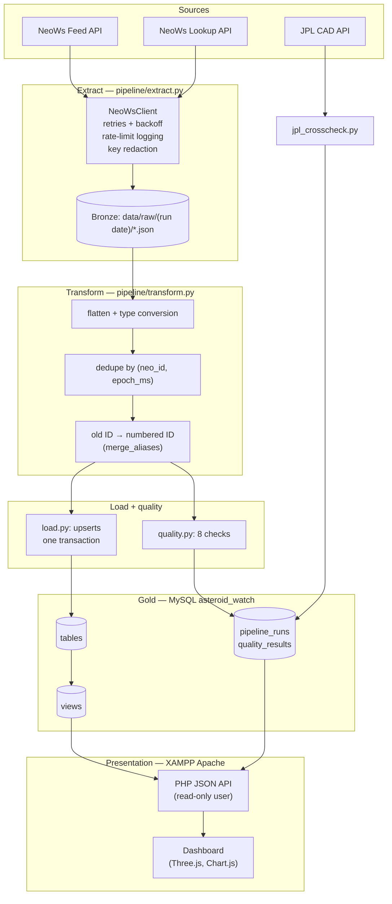

# Architecture

This document explains how Asteroid Watch is built and why each design decision was made. For setup and commands, see the [README](../README.md).

## 1. Overview



| Layer | Technology | Responsibility |
|---|---|---|
| Extract | Python 3, `requests` | Call NASA, handle errors and rate limits, save raw JSON |
| Transform | Python (standard library) | Turn nested JSON into flat, typed, deduplicated rows |
| Load | `PyMySQL` | Upsert rows into MySQL in one transaction |
| Quality | Python + SQL | Check every run; store the results |
| Storage | MariaDB 10.4 (XAMPP) | Tables, keys, indexes, views |
| Serving | PHP 8.2 + PDO on Apache (XAMPP) | JSON API, input validation |
| Presentation | HTML/CSS/JS (ES modules), Three.js, Chart.js | Interactive dashboard |
| Scheduling | macOS `launchd` | Run the pipeline daily at 09:00 |

## 2. Extract

**The feed's 7-day limit.** NeoWs returns at most 7 days per request, so `date_chunks()` splits any range into 7-day pieces. The one-year backfill (396 days) takes exactly **57** calls, and a unit test checks that number.

**Retries.** `NeoWsClient.get_json()` handles failures like this:

| Response | Action |
|---|---|
| 200 | Return the JSON |
| 429 (rate limited) or 5xx (server error) | Wait 2 s, 4 s, 8 s, 16 s (exponential backoff), or the server's `Retry-After` value, then retry |
| Network error (timeout, DNS…) | Retry the same way |
| Other 4xx (e.g. 403 bad key) | Stop at once. Retrying can't fix it. |

**Rate limit.** Every response carries `X-RateLimit-Remaining`. The client logs it and warns below 50. This key's limit is 2,000 requests/hour; a full backfill uses about 560.

**Bronze layer.** Each response is saved unchanged in `data/raw/<run date>/`, so a run can be audited or re-processed without calling NASA again. There's one problem to handle here: NeoWs embeds `api_key=...` in every `links` URL in its responses, and `requests` puts the full URL in its error messages. So the client **redacts the key** from both before anything is saved or logged, and tests check this.

**Orbital data** comes from one Lookup call per asteroid. A backfill finds about 1,700 asteroids, which is more than an hour's rate limit, so lookups are **capped per run**: 100 by default, hazardous asteroids and the latest approaches first. They're **cached**, and refetched only after 30 days.

## 3. Transform

NeoWs JSON is nested four levels deep:

```
near_earth_objects
  └─ "2026-10-17": [ asteroid, ... ]
        ├─ id, name, estimated_diameter.meters.{min,max}, is_potentially_hazardous_asteroid, ...
        └─ close_approach_data: [ { close_approach_date, epoch_date_close_approach,
                                    relative_velocity.{kilometers_per_second, ...},
                                    miss_distance.{kilometers, lunar, astronomical} } ]
```

`transform_feeds()` produces two flat lists, **asteroids** and **approaches**:

- **Type conversion:** NASA sends most numbers as text (`"23.6179645803"`, `".3163"`). `to_float()` converts them, and bad values become `NULL` instead of crashing. Dates are parsed, including NeoWs's `2026-Oct-19 00:44` format.
- **Units:** diameters are taken in metres (km × 1000 if the metre value is missing). Miss distances are kept in km, lunar distances (LD) and AU. Speeds are kept in km/s and km/h.
- **Dedupe:** asteroids are keyed by `neo_id` and approaches by `(neo_id, epoch_ms)`, so overlapping chunks or re-runs never produce duplicates.
- **Old ID → numbered ID** (`merge_aliases`): NeoWs sometimes lists one asteroid under both an old provisional ID and its newer numbered ID. When a designation appears under several IDs and exactly one is numbered, the others become aliases. Their approaches are stored under the numbered ID, and a copy within 60 minutes of an existing approach is dropped. Aliases are remembered in `neo_id_aliases` for later runs. Full story: [duplicate_ids.md](duplicate_ids.md).
- **Rejects:** records that can't be stored at all (no ID, date or time) are rejected and counted, which feeds the `not_null_keys` check.

## 4. Load

**Upserts.** `INSERT … ON DUPLICATE KEY UPDATE`: if the key already exists, the row is updated, not duplicated. This makes every run **idempotent**: running the same range twice gives the same database.

**Counting inserts vs updates.** For an upsert, MySQL reports *affected rows* as 1 per inserted row plus 2 per changed row (and 0 for unchanged ones). The loader counts the table before and after:

```
inserted = rows_after − rows_before
updated  = (affected − inserted) / 2
```

**Transactions.** Asteroids, approaches and new aliases go in one transaction, because approaches and aliases reference asteroids through foreign keys. If anything fails, the whole batch rolls back.

**Batching.** Rows go in batches of 500 using `executemany`, which PyMySQL turns into multi-row `INSERT`s.

## 5. Data quality

`quality.py` runs 8 checks after every load and stores one row per check in `quality_results`; `pipeline_runs.quality_failures` counts the failures. **A failed check doesn't stop the run.** The data is still loaded, and the failure is recorded and shown on the dashboard. This is a deliberate choice: the most common failure, missing days in the NeoWs feed, is NASA's problem, and the other days' data is still valid.

The JPL cross-check (`jpl_crosscheck.py`) is a separate, occasional run. It compares a reproducible random sample (seed 42) with NASA JPL's Close-Approach Data API, using the SPK-ID, which NeoWs uses as `neo_id`. Its results are stored as a `crosscheck` run, and the dashboard shows them as *findings* rather than failures.

## 6. Storage

See [er_diagram.md](er_diagram.md) for every table and index.

- **Natural keys:** `asteroids.neo_id` is NASA's ID. `close_approaches` has a surrogate `id` plus `UNIQUE(neo_id, epoch_ms)`, the business key that prevents duplicates.
- **Indexes:** `approach_date` for date-range filters, `miss_distance_km` for "closest" sorting, and `is_potentially_hazardous` for the hazard filter.
- **Views (gold layer):** these keep dashboard SQL simple. Examples are `v_upcoming_approaches`, which joins the tables and filters to `CURDATE()` onwards, and `v_top_closest`.
- **Audit trail:** every run, successful or not, is a row in `pipeline_runs` with its date range, API calls, records extracted, records after dedupe, rows inserted/updated, quality failures and any error message.

## 7. Serving: the PHP API

Five endpoints in `dashboard/api/` return JSON (see [api.md](api.md)):

- **PDO prepared statements only,** with `ATTR_EMULATE_PREPARES = false`, so values are always bound and never concatenated into SQL. Things that can't be bound, like sort columns, come from fixed whitelists.
- **Input validation** happens before any query: dates must be valid `YYYY-MM-DD`, page numbers are within limits, enums come from fixed lists, and search text is at most 50 characters, with `%`/`_` matched literally.
- **Errors** come back as JSON with the right status: 400 for bad input, 404 for not found, 405 for wrong method, 503 for MySQL down ("Is XAMPP MySQL running?") and 500 for anything else. Internal details go only to Apache's error log.

## 8. Presentation: the dashboard

`dashboard/index.php` is an HTML shell that never queries the database, so the page still loads and explains itself when MySQL is off. JavaScript ES modules in `assets/js/` fetch the API:

| Module | Role |
|---|---|
| `main.js` | Loads data and wires up every section |
| `space.js` | Three.js scene. Earth is a GLSL shader that cross-fades from a procedural planet to the NASA Blue Marble texture. This week's approaches are instanced rock meshes on log-scaled orbits. The module handles parallax, drag, hover and click picking, pausing when the tab is hidden, adaptive resolution and reduced motion. It also keeps every orbit clear of the hero text, using the measured text width and the perspective formula r/√(1−(r/D)²). |
| `charts.js` | Four Chart.js charts. The two colours were checked with a colour-blindness validator. |
| `table.js` | Server-side search, filter, sort and pagination |
| `modal.js` | Asteroid detail. The orbit sketch uses Kepler's third law (a³ = P²) to get the orbit's size from its period. |
| `health.js` | Pipeline runs and quality checks |
| `format.js`, `api.js`, `ui.js` | Formatting, the fetch wrapper, animations |

Database text is only ever inserted with `textContent`, never `innerHTML`, so names from NASA can't inject markup; a test enforces this. All libraries and fonts are **vendored** in `assets/vendor/`, with their licences and checked hashes, so the page works offline. A test confirms the page loads nothing from external hosts.

## 9. Security

| Concern | Measure |
|---|---|
| NASA API key | Only in `.env` (gitignored, `chmod 600`). Hidden from `repr()`, redacted from raw files and error messages. Never sent to PHP. |
| Database users | `asteroid_user` (pipeline) has rights only on `asteroid_watch`. `asteroid_reader` (dashboard) can only `SELECT`. `root` is used only by `setup_db.py` and backups. |
| Dashboard credentials | Written by `make deploy` to `/Applications/XAMPP/xamppfiles/etc/asteroid-watch/db.ini`, outside the web root. Apache can't read `.env` inside the home folder. |
| SQL injection | Prepared statements with bound values; whitelisted identifiers; identifier validation in Python |
| XSS | `textContent` only; JPL links restricted to `*.nasa.gov` |
| Web exposure | `includes/` blocked by `.htaccess` (403), directory listings off |
| Git history | Before each commit, staged files were scanned for the API key and both passwords |

## 10. Scheduling

`scheduler/com.asteroidwatch.pipeline.plist` is a launchd agent template. `make schedule-install` fills in the project path and loads it with `launchctl bootstrap`. It runs `run_pipeline --backfill-days 1 --forward-days 7 --run-type daily` at 09:00 local time (IST). If the Mac was asleep, launchd runs it once on wake. Output goes to `logs/pipeline.log` (rotating) and `logs/launchd.*.log`.

## 11. Failure handling

| Failure | What happens |
|---|---|
| NASA rate limit / server error | Retried with backoff, then the run fails with a clear message and is marked `failed` |
| Bad API key | Fails immediately (HTTP 403), with no retries |
| Some lookups fail | That asteroid is skipped; after 5 failures orbital fetching stops for the run |
| Load error | The transaction rolls back and the run is marked `failed` with the (redacted) error |
| MySQL off at 09:00 | The run can't be recorded; the error goes to `logs/pipeline.log`; the dashboard shows the last run's age and warns after 26 hours |
| MySQL off while viewing | The API returns 503; the dashboard shows "Database offline", "–" placeholders and a Retry button. It never shows made-up numbers. |

## 12. Testing

- **`make test`** runs 96 tests and needs **no internet and no database**. The fixtures are real NASA responses, trimmed and with the key redacted. The tests cover:
  - chunking and the 57-call backfill
  - retries, backoff and `Retry-After`
  - key redaction
  - type conversion
  - dedupe and the old-ID → numbered-ID mapping
  - upsert counting
  - every quality check
  - JPL comparison logic
  - PHP lint, input validation and MySQL-down messages
  - vendored-file hashes and no external loads
- **`make api-test`** runs 10 tests that call the deployed API and compare its answers with direct SQL. They also try an SQL-injection attempt and check that `includes/` returns 403.
