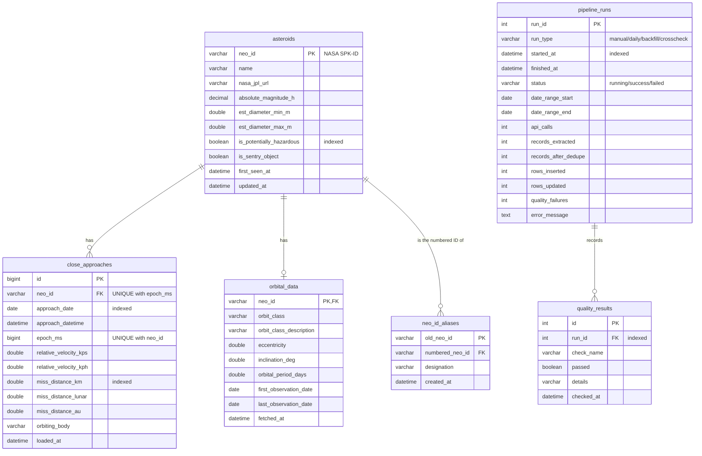

# Database: ER diagram and schema

Database `asteroid_watch` (MariaDB 10.4 in XAMPP, InnoDB, `utf8mb4`). The definitions are in [`sql/01_schema.sql`](../sql/01_schema.sql), [`sql/02_views.sql`](../sql/02_views.sql) and [`sql/03_migrations.sql`](../sql/03_migrations.sql); all three are safe to re-run.

## Tables

### `asteroids`: one row per asteroid

| Column | Type | Notes |
|---|---|---|
| `neo_id` | VARCHAR(20), **PK** | NASA's ID (the JPL SPK-ID), e.g. `2614134` |
| `name` | VARCHAR(100) | e.g. `614134 (2008 TC4)`; the designation is the text in brackets |
| `nasa_jpl_url` | VARCHAR(255) | Link to JPL's Small-Body Database page |
| `absolute_magnitude_h` | DECIMAL(6,3) | Brightness; a lower H means a bigger object |
| `est_diameter_min_m`, `est_diameter_max_m` | DOUBLE | Estimated size range in metres |
| `is_potentially_hazardous` | BOOLEAN, **indexed** | NASA's PHA classification |
| `is_sentry_object` | BOOLEAN | On JPL's Sentry impact-monitoring list |
| `first_seen_at`, `updated_at` | DATETIME | When the pipeline first and last changed the row |

### `close_approaches`: one row per pass of an asteroid near a body (Earth)

| Column | Type | Notes |
|---|---|---|
| `id` | BIGINT AUTO_INCREMENT, **PK** | Surrogate key |
| `neo_id` | VARCHAR(20), **FK → asteroids**, ON DELETE CASCADE | |
| `approach_date` | DATE, **indexed** | Used for date-range filters |
| `approach_datetime` | DATETIME | Closest-approach time |
| `epoch_ms` | BIGINT | The same moment as milliseconds since 1970 |
| `relative_velocity_kps`, `relative_velocity_kph` | DOUBLE | Speed relative to Earth |
| `miss_distance_km` | DOUBLE, **indexed** | Used for "closest" sorting |
| `miss_distance_lunar`, `miss_distance_au` | DOUBLE | 1 LD ≈ 384,400 km; 1 AU ≈ 149.6 million km |
| `orbiting_body` | VARCHAR(20) | `Earth` for every feed record |
| `loaded_at` | DATETIME | Last insert or change |

**`UNIQUE(neo_id, epoch_ms)`** is the rule that makes re-runs safe: the same asteroid can't have two approaches at the same moment, so loading a range twice inserts nothing new.

### `orbital_data`: orbit of an asteroid (from NeoWs Lookup; optional, cached)

| Column | Type | Notes |
|---|---|---|
| `neo_id` | VARCHAR(20), **PK and FK → asteroids** | One-to-one with `asteroids` |
| `orbit_class`, `orbit_class_description` | VARCHAR | e.g. `APO`, "Near-Earth asteroid orbits which cross the Earth's orbit…" |
| `eccentricity` | DOUBLE | 0 = circle, close to 1 = very elongated |
| `inclination_deg` | DOUBLE | Tilt relative to Earth's orbital plane |
| `orbital_period_days` | DOUBLE | Time for one orbit of the Sun |
| `first_observation_date`, `last_observation_date` | DATE | Observation arc |
| `fetched_at` | DATETIME | Always set on upsert; rows older than 30 days are refetched |

### `neo_id_aliases`: old provisional ID → numbered ID

| Column | Type | Notes |
|---|---|---|
| `old_neo_id` | VARCHAR(20), **PK** | e.g. `3430309` (no FK, because the old asteroid row is removed) |
| `numbered_neo_id` | VARCHAR(20), **FK → asteroids**, indexed | e.g. `2614134` |
| `designation` | VARCHAR(50) | e.g. `2008 TC4` |
| `created_at` | DATETIME | |

See [duplicate_ids.md](duplicate_ids.md) for why this table exists.

### `pipeline_runs`: one row per run (the audit log)

| Column | Notes |
|---|---|
| `run_id` (PK), `run_type`, `status` | `run_type` is manual / daily / backfill / crosscheck; `status` is running / success / failed |
| `started_at` (indexed), `finished_at` | Duration = difference |
| `date_range_start`, `date_range_end` | The range requested from NASA |
| `api_calls` | Every HTTP attempt, retries included |
| `records_extracted` | Approach records in the raw JSON |
| `records_after_dedupe` | Left after removing duplicate listings (NULL for runs before this column existed) |
| `rows_inserted`, `rows_updated` | For `close_approaches` |
| `quality_failures` | Number of failed checks (findings, for cross-check runs) |
| `error_message` | For failed runs, with the API key redacted |

### `quality_results`: one row per check per run

| Column | Notes |
|---|---|
| `id` (PK), `run_id` (**FK → pipeline_runs**, indexed, ON DELETE CASCADE) | |
| `check_name`, `passed`, `details` | e.g. `expected_days_fetched`, false, "392 of 396 requested days returned…" |
| `checked_at` | |

## Views (gold layer)

| View | Purpose | Used by |
|---|---|---|
| `v_upcoming_approaches` | Approaches from `CURDATE()` onwards, joined with asteroid details | Summary tiles |
| `v_daily_counts` | Approaches and hazardous approaches per day | Chart data checks |
| `v_hazardous_summary` | Asteroid and approach counts, hazardous vs not | Reports |
| `v_top_closest` | The 10 closest approaches on record | "Closest on record" |
| `v_top_largest` | The 10 largest asteroids by maximum estimated diameter | "Largest object" tile |

## Users and privileges

| User | Privileges | Used by |
|---|---|---|
| `asteroid_user@localhost` / `@127.0.0.1` | SELECT, INSERT, UPDATE, DELETE, CREATE, ALTER, INDEX, REFERENCES, DROP, CREATE VIEW, SHOW VIEW, **on `asteroid_watch` only** (MariaDB needs DROP for `CREATE OR REPLACE VIEW`) | Python pipeline |
| `asteroid_reader@localhost` / `@127.0.0.1` | SELECT, SHOW VIEW on `asteroid_watch` only | PHP dashboard |
| `root` | XAMPP admin (no password by default) | `setup_db.py`, `mysqldump` backups |

## Current size (2026-10-12)

| Table | Rows |
|---|---|
| asteroids | 1,627 |
| close_approaches | 1,876 |
| orbital_data | 578 |
| neo_id_aliases | 57 |
| pipeline_runs | 9 |
| quality_results | 41 |
